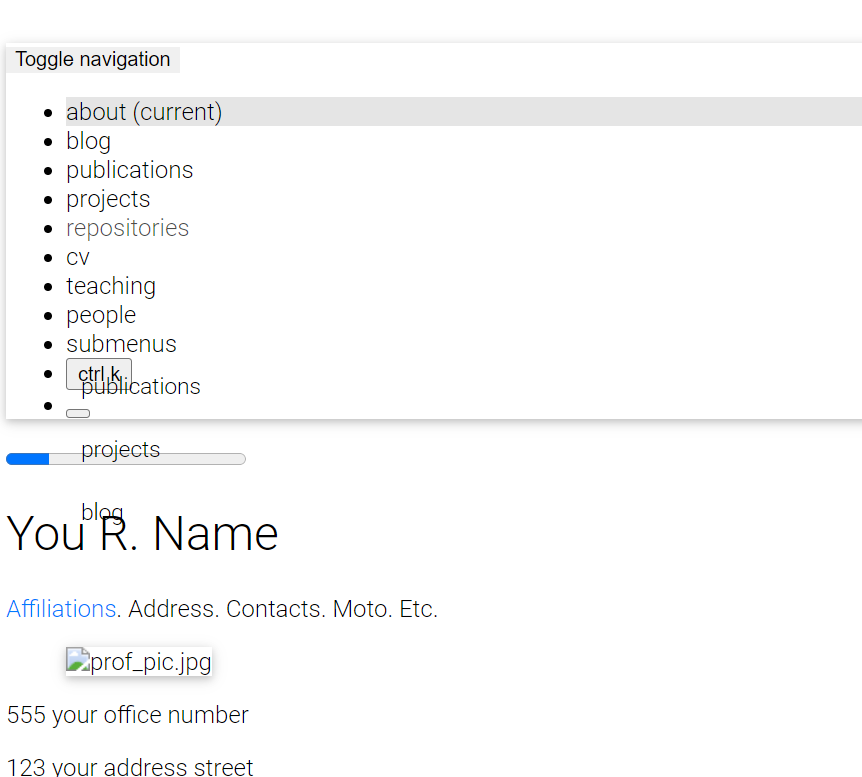

# Frequently Asked Questions

Here are some frequently asked questions. If you have a different question, please check if it was not already answered in the Q&A section of the [GitHub Discussions](https://github.com/alshedivat/al-folio/discussions).

- [After I create a new repository from this template and setup the repo, I get a deployment error. Isn't the website supposed to correctly deploy automatically?](#after-i-create-a-new-repository-from-this-template-and-setup-the-repo-i-get-a-deployment-error-isnt-the-website-supposed-to-correctly-deploy-automatically)
- [I am using a custom domain (e.g., `foo.com`). My custom domain becomes blank in the repository settings after each deployment. How do I fix that?](#i-am-using-a-custom-domain-eg-foocom-my-custom-domain-becomes-blank-in-the-repository-settings-after-each-deployment-how-do-i-fix-that)
- [My webpage works locally. But after deploying, it fails to build and throws `Unknown tag 'toc'`. How do I fix that?](#my-webpage-works-locally-but-after-deploying-it-fails-to-build-and-throws-unknown-tag-toc-how-do-i-fix-that)
- [My webpage works locally. But after deploying, it is not displayed correctly (CSS and JS are not loaded properly). How do I fix that?](#my-webpage-works-locally-but-after-deploying-it-is-not-displayed-correctly-css-and-js-are-not-loaded-properly-how-do-i-fix-that)
- [Atom feed doesn't work. Why?](#atom-feed-doesnt-work-why)
- [My site doesn't work when I enable `related_blog_posts`. Why?](#my-site-doesnt-work-when-i-enable-related_blog_posts-why)
- [When trying to deploy, it's asking for github login credentials, which github disabled password authentication and it exits with an error. How to fix?](#when-trying-to-deploy-its-asking-for-github-login-credentials-which-github-disabled-password-authentication-and-it-exits-with-an-error-how-to-fix)
- [When I manually run the Lighthouse Badger workflow, it fails with `Error: Input required and not supplied: token`. How do I fix that?](#when-i-manually-run-the-lighthouse-badger-workflow-it-fails-with-error-input-required-and-not-supplied-token-how-do-i-fix-that)
- [My code runs fine locally, but when I create a commit and submit it, it fails with `prettier code formatter workflow run failed for main branch`. How do I fix that?](#my-code-runs-fine-locally-but-when-i-create-a-commit-and-submit-it-it-fails-with-prettier-code-formatter-workflow-run-failed-for-main-branch-how-do-i-fix-that)
- [After I update my site with some new content, even a small change, the GitHub action throws an error or displays a warning. What happened?](#after-i-update-my-site-with-some-new-content-even-a-small-change-the-github-action-throws-an-error-or-displays-a-warning-what-happened)
- [I am trying to deploy my site, but it fails with `Could not find gem 'jekyll-diagrams' in locally installed gems`. How do I fix that?](#i-am-trying-to-deploy-my-site-but-it-fails-with-could-not-find-gem-jekyll-diagrams-in-locally-installed-gems-how-do-i-fix-that)
- [How can I update Font Awesome version on the template](#how-can-i-update-font-awesome-version-on-the-template)
- [What do all these GitHub actions/workflows mean?](#what-do-all-these-github-actionsworkflows-mean)

---

### After I create a new repository from this template and setup the repo, I get a deployment error. Isn't the website supposed to correctly deploy automatically?

Yes, if you are using release `v0.3.5` or later, the website will automatically and correctly re-deploy right after your first commit. Please make some changes (e.g., change your website info in `_config.yml`) and push them to your repository.

---

### I am using a custom domain (e.g., `foo.com`). My custom domain becomes blank in the repository settings after each deployment. How do I fix that?

You need to add `CNAME` file to the `main` or `source` branch of your repository. The file should contain your custom domain name.

---

### My webpage works locally. But after deploying, it fails to build and throws `Unknown tag 'toc'`. How do I fix that?

Make sure you followed through the deployment instructions in the previous section. You should have set the deployment branch to `gh-pages`.

---

### My webpage works locally. But after deploying, it is not displayed correctly (CSS and JS are not loaded properly). How do I fix that?

If the website does not load the theme, the layout looks weird, and all links are broken, being the main page displayed this way:



make sure to correctly specify the `url` and `baseurl` paths in `_config.yml`. Set `url` to `https://<your-github-username>.github.io` or to `https://<your.custom.domain>` if you are using a custom domain. Then `baseurl` should be empty for user pages or `/<repository-name>/` for project pages.

- press Shift + F5 on Chromium-based browsers or Ctrl + F5 on Firefox-based browsers
- clean your browser history
- simply try it in a private session

---

### Atom feed doesn't work. Why?

Make sure to correctly specify the `url` and `baseurl` paths in `_config.yml`. RSS Feed plugin works with these correctly set up fields: `title`, `url`, `description` and `author`.

---

### My site doesn't work when I enable `related_blog_posts`. Why?

This is probably due to the classifier reborn plugin, which is used to calculate related posts. If the error states `Liquid Exception: Zero vectors cannot be normalized`, it means the plugin could not compute related posts due to insufficient data.

---

### When trying to deploy, it's asking for github login credentials, which github disabled password authentication and it exits with an error. How to fix?

Open `.git/config` in your local repository using your preferred editor. Change the `https` portion of the `url` variable to `ssh`. Try deploying again.

---

### When I manually run the Lighthouse Badger workflow, it fails with `Error: Input required and not supplied: token`. How do I fix that?

You need to create a personal access token and add it as a secret named `LIGHTHOUSE_BADGER_TOKEN` to your repository. For more information, check the workflow documentation in your repository or GitHub Docs.

---

### My code runs fine locally, but when I create a commit and submit it, it fails with `prettier code formatter workflow run failed for main branch`. How do I fix that?

We implemented support for Prettier code formatting. It basically ensures that your code is well formatted. If you want to ensure your code is compliant with Prettier, you have a few options:

- if you are running locally with `Docker` and using development containers, Prettier is already included
- if you don't use `Docker`, it is simple to integrate it with your preferred IDE using an extension
- if you want to run it manually, you can follow the first 2 steps in a Node installation tutorial, then install it using `npm install prettier` inside the project directory or install it globally on your computer using `npm install -g prettier`. To run Prettier on your current directory use `npx prettier . --write`.

You can also disable it for your repo. For this, just delete the file `.github/workflows/prettier.yml`.

---

### After I update my site with some new content, even a small change, the GitHub action throws an error or displays a warning. What happened?

Probably your GitHub workflow is throwing an error like this:

```bash
/opt/hostedtoolcache/Ruby/3.0.2/x64/lib/ruby/gems/3.0.0/gems/bundler-2.5.5/lib/bundler/runtime.rb:304:in `check_for_activated_spec!': You have already activated uri 0.10.1, but your Gemfile requires uri 0.13.0. Since uri is a default gem, you can either remove your dependency on it or try updating to a newer version of bundler that supports uri as a default gem. (Gem::LoadError)
```

or maybe displaying a warning like one of these:

```
Node.js 16 actions are deprecated. Please update the following actions to use Node.js 20.
```

If that's the case, you are using deprecated libraries/commands. This happens because you are using a very old version of al-folio. To fix this it is recommended upgrading your code to the latest version.

---

### I am trying to deploy my site, but it fails with `Could not find gem 'jekyll-diagrams' in locally installed gems`. How do I fix that?

`jekyll-diagrams` support was dropped in favor of using Mermaid directly. Simply update your code to the newer version of the template and remove the old plugin reference.

---

### How can I update Font Awesome version on the template

To update the Font Awesome version, you need to download the latest release "for the web" from the Font Awesome website. After downloading, extract the zip file and replace the relevant files in the `assets/` directory or use the package manager for your project.

---

### What do all these GitHub actions/workflows mean?

GitHub actions are a way to automate tasks in the repository. They are defined in `.github/workflows/` directory. Each file in this directory is a workflow. Workflows are made up of one or more jobs that run automatically when certain trigger events happen.

Currently we have the following workflows:

- `axe.yml`: does some accessibility testing in your site
- `broken-links-site.yml`: checks for broken links in your built website with lychee
- `broken-links.yml`: checks for broken links in your repository with lychee
- `deploy-docker-tag.yml`: adds metadata to the docker image and pushes it to Docker Hub
- `deploy-image.yml`: deploys a new docker image with the latest changes to Docker Hub
- `deploy.yml`: deploys the website to GitHub Pages
- `docker-slim.yml`: deploys a smaller version of the docker image to Docker Hub with docker-slim-action
- `lighthouse-badger.yml`: runs a lighthouse test for your site with the lighthouse-badger-action
- `prettier.yml`: runs Prettier on the code to ensure it is well formatted

